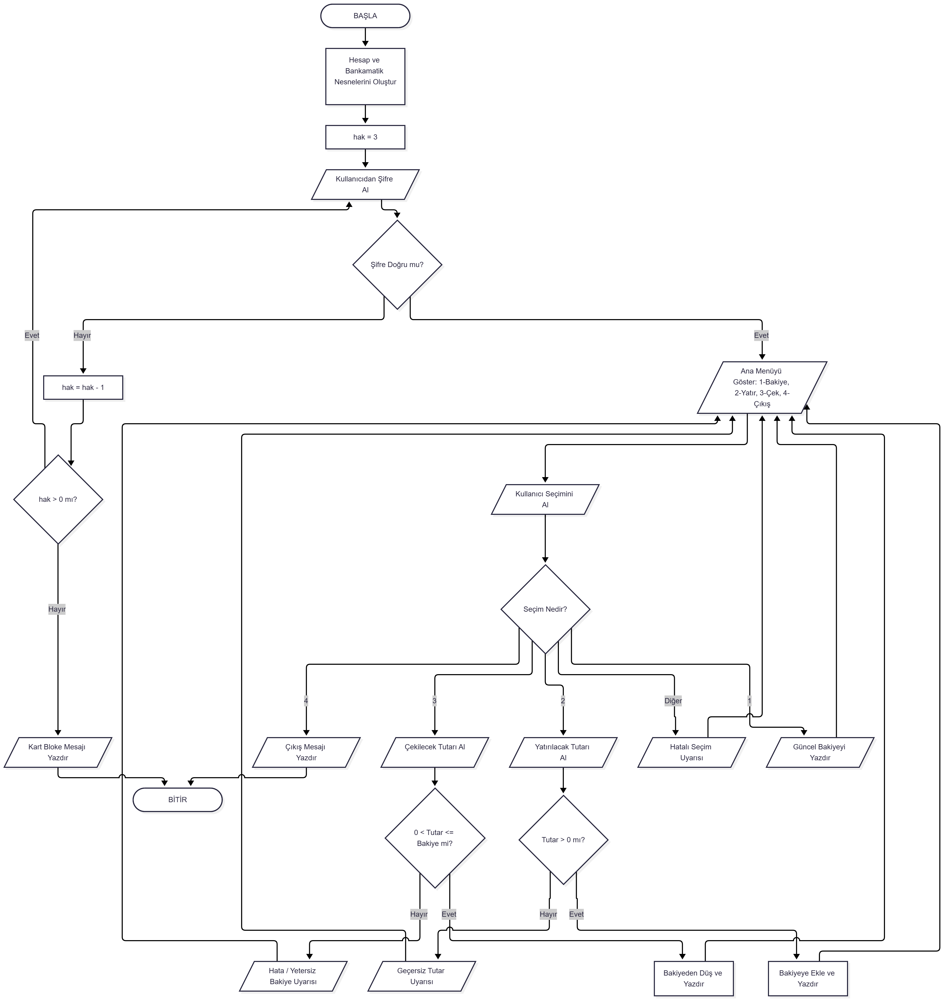

# 🏦 Python Bankamatik (ATM) Sistemi

Bu proje, **Uludağ Üniversitesi Yapay Zeka Topluluğu (TALOS)** 1. Hafta Python Giriş eğitimi kapsamında Nesne Tabanlı Programlama (OOP), koşul yapıları ve döngüler kullanılarak geliştirilmiştir.

## 🚀 Projenin Amacı ve Özellikleri
Kullanıcıların şifre doğrulaması yaparak hesaplarına erişebildiği, bakiye sorgulama, para yatırma ve para çekme işlemlerini gerçekleştirebildiği konsol tabanlı bir bankacılık simülasyonudur.

* **Güvenli Giriş:** 3 hatalı şifre denemesinde kart bloke edilir.
* **Hata Kontrolü:** Negatif tutar girişleri ve yetersiz bakiye durumları kontrol edilir.
* **Modüler Yapı:** Veri modeli (`Hesap`) ve işlem yöneticisi (`Bankamatik`) sınıfları birbirinden ayrılmıştır.

## 🏗️ Sınıf ve Fonksiyon Mimarisi
* **`Hesap` Sınıfı:** Müşterinin ad-soyad, şifre ve bakiye bilgilerini tutar.
* **`Bankamatik` Sınıfı:** `sifre_dogrula()`, `bakiye_goster()`, `para_yatir()` ve `para_cek()` metotları ile tüm bankacılık işlemlerini yönetir.

## 📊 Akış Şeması (Flowchart)


## 💻 Nasıl Çalıştırılır?
1. Bilgisayarınızda Python 3 yüklü olduğundan emin olun.
2. `bankamatik.py` dosyasını indirin ve terminalde çalıştırın:
   ```bash
   python bankamatik.py
